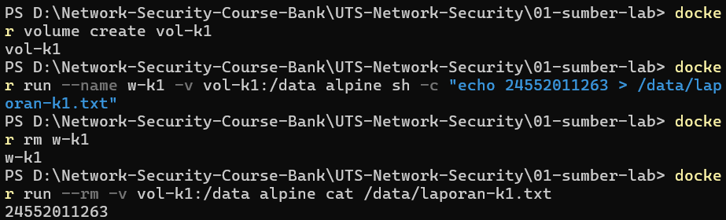
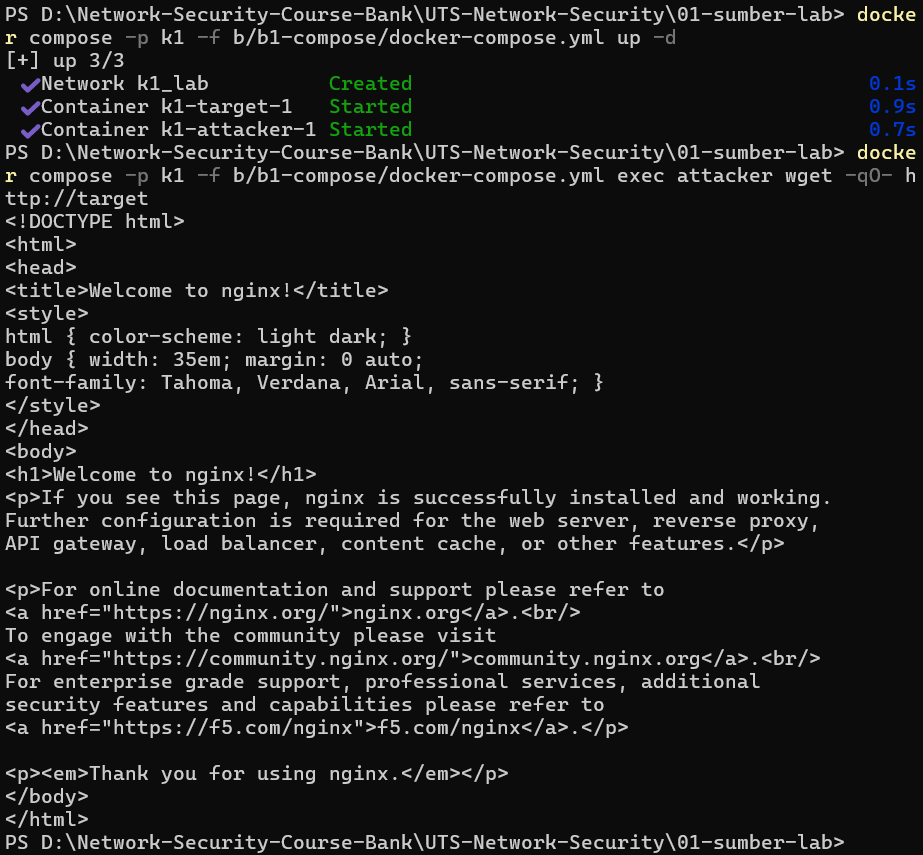
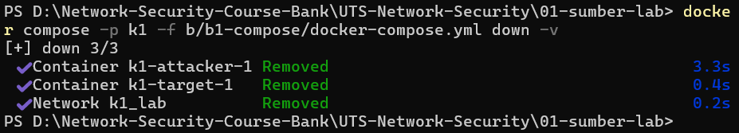

# Tugas 1 (Pertemuan 1): Docker dan Volume

File di folder ini:
- `docker-compose.yml` (konfigurasi jaringan `internal: true` dari `b/b1-compose`)
- `screenshots/01-volume-persistensi.png`
- `screenshots/02-compose-nginx.png`
- `screenshots/03-compose-down.png`

# Perintah yang Dijalankan

1A. Uji Persistensi Volume `vol-k1`:
```powershell
docker volume create vol-k1
docker run --name w-k1 -v vol-k1:/data alpine sh -c "echo 24552011263 > /data/laporan-k1.txt"
docker rm w-k1
docker run --rm -v vol-k1:/data alpine cat /data/laporan-k1.txt
```

1B. Docker Compose Jaringan Internal (`b1-compose`):
```powershell
docker compose -p k1 -f b/b1-compose/docker-compose.yml up -d
docker compose -p k1 -f b/b1-compose/docker-compose.yml exec attacker wget -qO- http://target
docker compose -p k1 -f b/b1-compose/docker-compose.yml down -v
```

# Hasil dan Penjelasan
- Volume `vol-k1` tetap menyimpan berkas `/data/laporan-k1.txt` berisi NIM `24552011263` setelah container `w-k1` dihapus karena Docker volume tersimpan di area persisten host di luar lapisan filesystem container.
- Container `attacker` pada stack `k1` berhasil mengambil halaman HTML `Welcome to nginx!` dari service `target` di jaringan internal `k1_lab`.

# Bukti Screenshot






