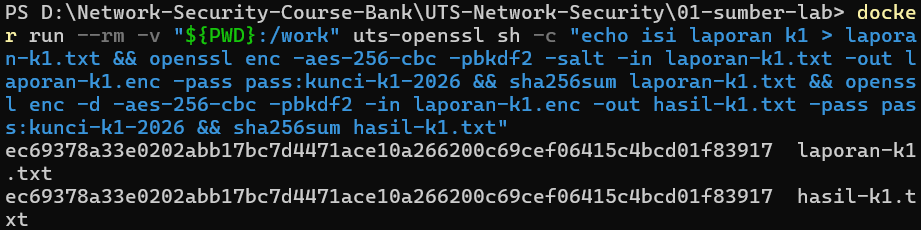
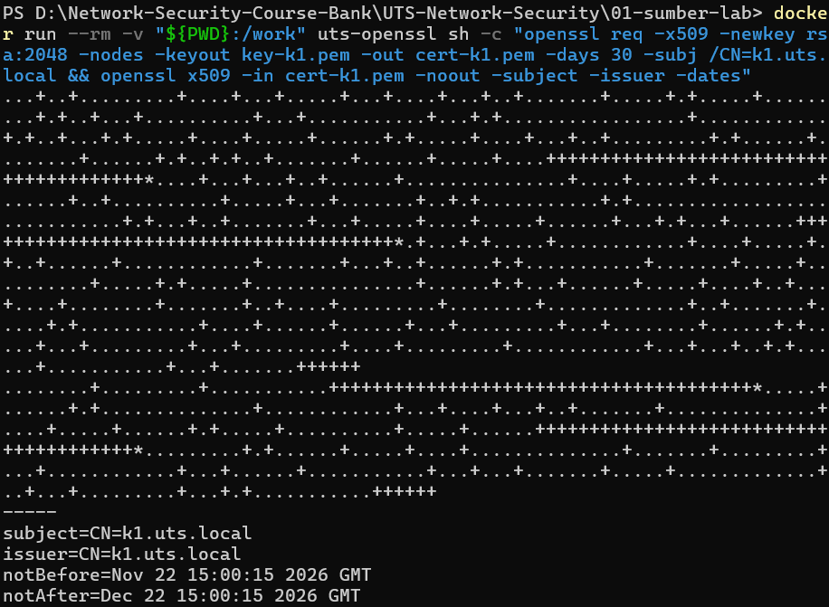

# Tugas 2 (Pertemuan 2): Kriptografi

File di folder ini:
- `laporan-k1.txt` (berkas teks awal)
- `laporan-k1.enc` (berkas terenkripsi AES-256-CBC)
- `hasil-k1.txt` (berkas hasil dekripsi)
- `cert-k1.pem` (sertifikat publik self-signed X.509; kunci privat tidak disertakan)
- `screenshots/01-aes256-sha256.png`
- `screenshots/02-sertifikat-self-signed.png`

# Perintah yang Dijalankan
```powershell
docker run --rm -v "${PWD}:/work" uts-openssl sh -c "echo isi laporan k1 > laporan-k1.txt && openssl enc -aes-256-cbc -pbkdf2 -salt -in laporan-k1.txt -out laporan-k1.enc -pass pass:kunci-k1-2026 && sha256sum laporan-k1.txt && openssl enc -d -aes-256-cbc -pbkdf2 -in laporan-k1.enc -out hasil-k1.txt -pass pass:kunci-k1-2026 && sha256sum hasil-k1.txt"

docker run --rm -v "${PWD}:/work" uts-openssl sh -c "openssl req -x509 -newkey rsa:2048 -nodes -keyout key-k1.pem -out cert-k1.pem -days 30 -subj /CN=k1.uts.local && openssl x509 -in cert-k1.pem -noout -subject -issuer -dates"
```

# Hasil dan Penjelasan
- Hash SHA-256 sebelum enkripsi (`laporan-k1.txt`) dan sesudah dekripsi (`hasil-k1.txt`) identik: `ec69378a33e0202abb17bc7d4471ace10a266200c69cef06415c4bcd01f83917`.
- Sertifikat `cert-k1.pem` menampilkan `subject=CN=k1.uts.local`, `issuer=CN=k1.uts.local`, `notBefore=Nov 22 15:00:15 2026 GMT`, dan `notAfter=Dec 22 15:00:15 2026 GMT`.
- Perbedaan sertifikat self-signed dan CA-signed: sertifikat self-signed ditandatangani sendiri oleh pemilik kunci privatnya (`subject` sama dengan `issuer`) sehingga tidak otomatis dipercaya sistem klien, sedangkan sertifikat CA-signed diverifikasi dan ditandatangani oleh pihak ketiga tepercaya (Certificate Authority).

# Bukti Screenshot




