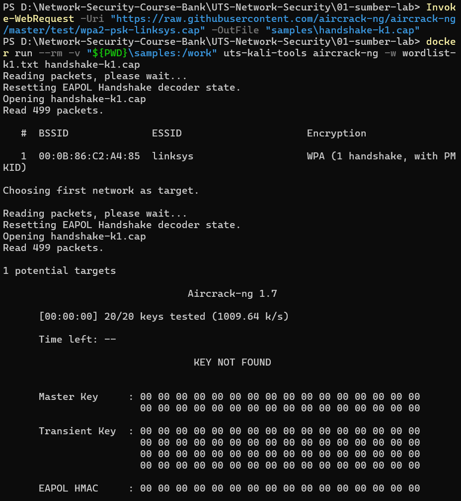

# Tugas 4 (Pertemuan 4): Analisis Handshake WPA2

File di folder ini:
- `wordlist-k1.txt` (daftar 20 kata sandi uji Kasus 1)
- `handshake-k1.cap` (berkas capture `wpa2-psk-linksys.cap` yang diunduh sesuai `CAPTURE-FILES-GUIDE.md` karena berkas bawaan awal repositori masih placeholder non-802.11)
- `screenshots/01-aircrack-ng-handshake.png`

# Perintah yang Dijalankan
```powershell
Invoke-WebRequest -Uri "https://raw.githubusercontent.com/aircrack-ng/aircrack-ng/master/test/wpa2-psk-linksys.cap" -OutFile "samples\handshake-k1.cap"
docker run --rm -v "${PWD}\samples:/work" uts-kali-tools aircrack-ng -w wordlist-k1.txt handshake-k1.cap
```

# Hasil dan Penjelasan
- `aircrack-ng` membaca 499 paket, mendeteksi target BSSID `00:0B:86:C2:A4:85` (ESSID `linksys`) dengan `WPA (1 handshake, with PMKID)`, menguji 20/20 kata sandi pada kecepatan `1009.64 k/s`, dan menampilkan hasil `KEY NOT FOUND`.
- Empat langkah 4-Way Handshake WPA2:
  1. Message 1 (AP ke Client): AP mengirim nilai acak ANonce; client menghitung PTK (Pairwise Transient Key) dari PMK, ANonce, SNonce, serta MAC AP dan client.
  2. Message 2 (Client ke AP): Client mengirim SNonce beserta MIC (Message Integrity Code) untuk membuktikan kepemilikan PMK; AP ikut menghitung PTK dan memverifikasi MIC.
  3. Message 3 (AP ke Client): AP mengirim GTK (Group Temporal Key) terenkripsi beserta MIC dan instruksi pemasangan kunci.
  4. Message 4 (Client ke AP): Client mengirim konfirmasi (ACK) disertai MIC bahwa kunci telah dipasang, lalu komunikasi terenkripsi dimulai.

# Bukti Screenshot


