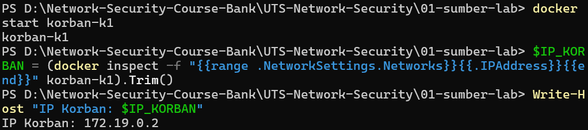
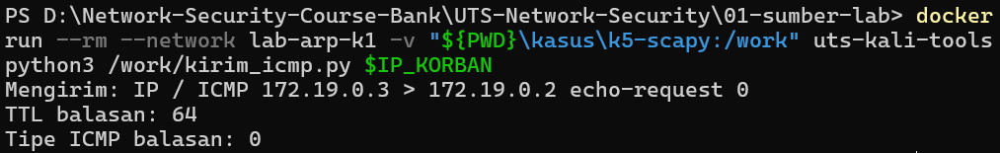

# Tugas 5 (Pertemuan 5): ICMP dengan Scapy

File di folder ini:
- `kirim_icmp.py` (skrip Scapy dari `kasus/k5-scapy`)
- `screenshots/01-start-korban-ip.png`
- `screenshots/02-scapy-icmp-reply.png`

# Perintah yang Dijalankan
```powershell
docker start korban-k1
$IP_KORBAN = (docker inspect -f "{{range .NetworkSettings.Networks}}{{.IPAddress}}{{end}}" korban-k1).Trim()
docker run --rm --network lab-arp-k1 -v "${PWD}\kasus\k5-scapy:/work" uts-kali-tools python3 /work/kirim_icmp.py $IP_KORBAN
```

# Hasil dan Penjelasan
- Skrip mengirim paket `IP / ICMP 172.19.0.3 > 172.19.0.2 echo-request 0` ke container `korban-k1`.
- Output balasan menampilkan `TTL balasan: 64` dan `Tipe ICMP balasan: 0` (ICMP Echo Reply).
- Penjelasan Smurf Attack: serangan DDoS berbasis amplifikasi ICMP di mana penyerang mengirim banyak paket ICMP Echo Request ke alamat broadcast jaringan dengan alamat IP sumber yang dipalsukan (spoofed) menjadi IP korban, sehingga seluruh host di jaringan broadcast membalas secara serentak ke korban dan membanjiri bandwidth maupun sumber daya korban.

# Bukti Screenshot




