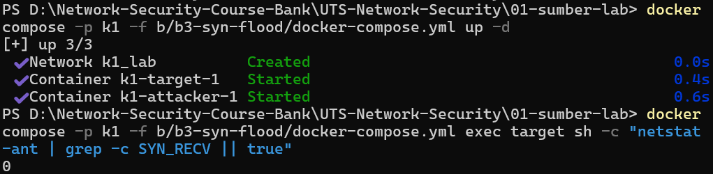
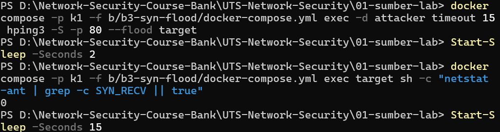
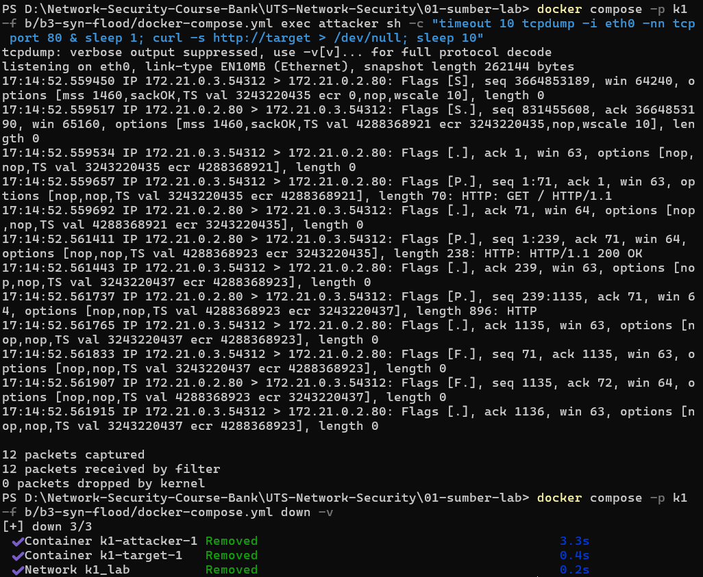

# Tugas 6 (Pertemuan 6): SYN Flood dan Three-Way Handshake (tcpdump)

File di folder ini:
- `docker-compose.yml` (konfigurasi lab SYN flood dari `b/b3-syn-flood`)
- `screenshots/01-syn-flood-up-sebelum.png`
- `screenshots/02-hping3-syn-recv.png`
- `screenshots/03-tcpdump-3way-handshake.png`

# Perintah yang Dijalankan
```powershell
docker compose -p k1 -f b/b3-syn-flood/docker-compose.yml up -d
docker compose -p k1 -f b/b3-syn-flood/docker-compose.yml exec target sh -c "netstat -ant | grep -c SYN_RECV || true"
docker compose -p k1 -f b/b3-syn-flood/docker-compose.yml exec -d attacker timeout 15 hping3 -S -p 80 --flood target
Start-Sleep -Seconds 2
docker compose -p k1 -f b/b3-syn-flood/docker-compose.yml exec target sh -c "netstat -ant | grep -c SYN_RECV || true"
Start-Sleep -Seconds 15
docker compose -p k1 -f b/b3-syn-flood/docker-compose.yml exec attacker sh -c "timeout 10 tcpdump -i eth0 -nn tcp port 80 & sleep 1; curl -s http://target > /dev/null; sleep 10"
docker compose -p k1 -f b/b3-syn-flood/docker-compose.yml down -v
```

# Hasil dan Penjelasan
- Jumlah `SYN_RECV` sebelum serangan adalah `0`, dan saat serangan berlangsung juga terbaca `0` karena `net.ipv4.tcp_syncookies = 1` aktif pada kernel dan kernel `attacker` membalas langsung dengan `RST` pada paket non-spoofed sehingga antrean half-open tidak menumpuk.
- Setelah serangan selesai, `tcpdump` berhasil menangkap 12 paket komunikasi normal port 80 yang memperlihatkan urutan three-way handshake: `Flags [S]` (SYN), `Flags [S.]` (SYN-ACK), dan `Flags [.]` (ACK), diikuti `HTTP GET /`, `HTTP/1.1 200 OK`, serta penutupan koneksi `Flags [F.]`.
- Mitigasi SYN flood: mengaktifkan SYN Cookies (`net.ipv4.tcp_syncookies=1`) dan menerapkan rate limiting paket SYN menggunakan firewall/`iptables`.

# Bukti Screenshot






